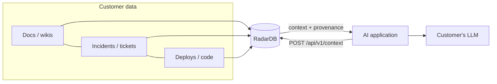
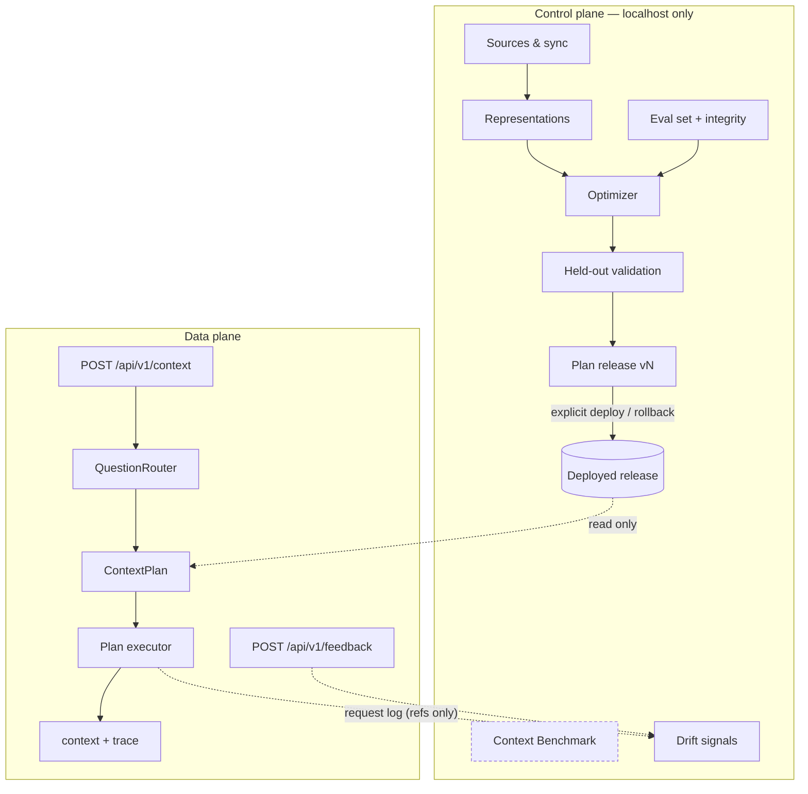
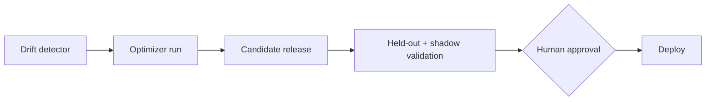

# RadarDB architecture (V1)

*Describes what exists in this repository today. Aspirations are marked **Future**.*

## 1. Product boundary

RadarDB is a **context optimizer for AI**. It sits between enterprise data and an application's LLM:



RadarDB is not an LLM, a chatbot, a vector database or a RAG framework. It never generates answers, and reasoning happens in the customer's LLM. RadarDB's job is to decide **how** context is assembled for each kind of question, prove that choice on held-out questions, and serve it.

Loop: **DATA → REPRESENT → RETRIEVE → MEASURE → LEARN → (re-represent)**.

## 2. Planes



| Plane | Code | Responsibilities |
|---|---|---|
| Control | `src/server/control.ts`, `src/app/api/*` (all but `v1`) | sources, eval set, optimizer runs, validation, plan releases, deploy/rollback, benchmark, drift |
| Data | `src/server/dataplane.ts`, `src/app/api/v1/*` | route → load deployed plan → execute → assemble → log. **Never optimizes, never mutates plans.** |
| Evaluation | `src/engine/evaluate.ts`, `integrity.ts`, `optimizer/validate.ts` | scoring, integrity checks, held-out validation |

Both planes run in one Next.js process today (**Future:** separate services; the data plane is stateless apart from read-only plans and representations).

## 3. Domain model (`src/core/domain.ts`)

`Source`, `Document`, `Chunk`, `Representation`, `EvalQuestion`, `WorkloadClass`, `PlanConfig`, `ContextPlan`, `PlanRelease`, `OptimizerRun`, `TrialSummary`, `ExperimentResult`, `ContextRequest`, `Feedback`, `Benchmark`, `IntegrityReport`, `Metrics`, `LatencyStats`, `Provenance`.

Workload classes are **data** (`WorkloadClass[]` declared by a router), not a type union. Plans are looked up by class id with a `"*"` fallback.

## 4. Source ingestion (`src/server/connectors/`)

`SourceConnector`: `connect · validate · sync · incrementalSync · getDocuments · getChanges · health`.

| Connector | Status | Notes |
|---|---|---|
| `FixtureConnector` | synthetic demo | Reads `data/demo/**`; files under `generated/` are marked `distractor`; every source is labeled `synthetic` |
| `FilesystemConnector` | **real** | Markdown/text under `RADAR_SOURCES_ROOT` (default `./sources`); path confinement, no symlinks, 2 MB/file, 5 000 files |
| Upload | real | Paste-in documents, ≤ 1 M chars |

Documents get `id = sourceId:externalId`, a sha1 `checksum`, and a `version` that increments when content changes. Incremental sync compares checksums. The **dataset version** is a hash over every document's id and checksum.

## 5. Representation layer (`src/engine/representations.ts`, `chunkers.ts`)

For each (dataset version, chunking strategy) RadarDB materializes a `RepresentationSet`:

- **chunk-set** (`FixedChunker` 512/64 and 256/32, `SectionChunker`, `SentenceWindowChunker`)
- **lexical-index**: BM25 (k1 1.2, b 0.75) over tokens that keep compound identifiers whole and split
- **vector-index**: per embedding model, built lazily (local MiniLM-L6 q8 ONNX; hashed char n-grams)
- **entity-graph**: regex-extracted tickets, deploys, PRs, commits, versions, services, flags → chunk ids

These are cached in-process by dataset version, and embeddings and rerank scores are cached on disk (`.radar/cache`). **Future:** persistent indexes in a real store; a structured/SQL representation.

## 6. Retrieval layer (`src/engine/retrievers.ts`, `rerankers.ts`, `assembler.ts`, `executor.ts`)

| Interface | Implementations |
|---|---|
| `Retriever` | `LexicalRetriever`, `VectorRetriever(model)`, `HybridRetriever` (RRF k=60), `ExactMatchBooster` (decorator: rare identifiers only) |
| secondary | `EntityGraphRetriever.expand()` follows rare identifiers from the top seeds (fan-out cap 8% of chunks), recording `graphPath` |
| `Reranker` | `NoReranker`, `CrossEncoderReranker` (ms-marco MiniLM-L6, pool 20) |
| `ContextAssembler` | dedupe (same chunk or ≥ 80% repeated sentences), greedy token budget, provenance on every item |

`executePlan(config, query, reps, opts)` is the single execution path used by the optimizer, validation, the Playground and the API: retrieve → (rerank, skipped if `maxLatencyMs` would be exceeded) → top-k → (graph expansion) → assemble. It returns items, a step trace with timings, `measuredLatencyMs` (wall-clock), `estimatedLatencyMs` and `estimatedCostUsd`.

## 7. Question routing (`src/engine/router.ts`)

`QuestionRouter { version, classes, fallbackThreshold, route(q) → {class, confidence, signals} }`. The V1 implementation, `RuleBasedRouter "rules-v1"`, is frozen. It uses noisy-OR signal weights, and ties break by class order (intent before identifiers). `resolvePlanClass()` sends low-confidence decisions, or classes without a plan, to the fallback plan. The same function is used in validation and serving. **Future:** learned or discovered workload classes behind the same interface.

## 8. Evaluation (`src/engine/evaluate.ts`, `integrity.ts`)

- **Required evidence coverage**: mean share of required evidence phrases contained in at least one context item. Phrases are not stitched across chunks.
- **Retrieval success**: share of questions with *all* evidence, with a Wilson 95% interval.
- **Context precision**: share of returned items containing any required evidence.
- Secondary: context tokens, **measured** latency (validation and serving), **estimated** latency and cost (`cost.ts`).
- The evaluation measures retrieval and evidence. It does **not** judge LLM answers.

**Splits** are assigned once (fixtures: stored in `evals.json`; new questions: hash of id, ~25% held-out) and persisted. **Integrity report** before every run: duplicate questions, near-duplicates and repeated templates across splits, evidence in question text, evidence in distractors, identifier collisions with distractors, missing evidence, duplicate documents and sources, unscorable questions.

## 9. Optimizer (`src/engine/optimizer/`)

```mermaid
sequenceDiagram
  participant C as ControlPlane.startRun
  participant O as optimize()
  participant V as validatePlans()
  C->>C: snapshot documents + questions, integrity report
  C->>O: optimization questions ONLY (throws otherwise)
  O->>O: materialize representations, calibrate model latency
  loop strategy.next(history)
    O->>O: executePlan(config) on every optimization question → ExperimentResult rows
  end
  O->>O: Pareto front; select fallback + one plan per routed class (objective, constraints)
  O-->>C: selections + explanations
  C->>C: create candidate PlanRelease vN (immutable plans)
  C->>V: held-out questions ONLY, after selection
  V-->>C: metrics, per-class, per-question, measured cold latency
  C->>C: release → validated (awaits explicit deploy)
```

- **Strategies** (`OptimizerStrategy`: `init`, `next(history)`, `budget`): `ExhaustiveSearch` (default; 480 configs, the ground truth) and `RandomSearch(n, seed)`. **Future:** `BayesianSearch`, `LearnedOptimizer` trained on `.radar/experiments/<run>.jsonl`. Every experiment row records configuration, question, scores, tokens, latency and corpus/question features.
- **Search space**: 4 chunkings × 5 retrieval/embedding combinations × exact-ID boost × graph × reranker × top-k {3,5,8} = 480.
- **Pareto front** over evidence coverage, context precision (max), and tokens, estimated latency, estimated cost (min).
- **Objectives**: balanced, quality, cost, latency, plus constraints (`maxTokens`, `maxCostUsd`, `maxLatencyMs`).
- **Explanations**: the best configuration per retrieval family, single-component ablations, and data-derived reasons ("Why this plan?").
- **Calibration**: the median of uncached model inferences after warm-up, measured at run start, used for estimated latency.

## 10. ContextPlan lifecycle and deployment (`control.ts`)

`candidate → validated → deployed → retired`. One `PlanRelease` (version N) groups one `ContextPlan` per learned class plus a fallback. Plan configs, metrics and explanations are deep-frozen and never edited; a new run always creates version N+1. Deployment is an explicit API call (`POST /api/plans/deploy`) and only accepts validated or previously deployed releases. Rollback redeploys the most recently retired release. Every `ContextRequest` records the plan id and version used.

## 11. API

| Endpoint | Plane | Purpose |
|---|---|---|
| `POST /api/v1/context` | data | `{query, constraints?}` → `{requestId, context[], plan, router, trace, metrics, notice}`; 409 if nothing deployed |
| `POST /api/v1/feedback` | data | `{requestId, useful, missingEvidence?, note?}` |
| `GET /api/workspace` | control | summary for the console |
| `GET/POST /api/sources`, `POST/DELETE /api/sources/:id` | control | list, connect folder, sync, remove |
| `GET/POST/DELETE /api/documents` | control | browse, upload, delete uploads |
| `GET/POST/DELETE /api/evals`, `GET /api/integrity` | control | eval set |
| `GET/POST /api/runs`, `GET /api/runs/:id` | control | optimizer |
| `GET /api/plans`, `POST /api/plans/deploy`, `POST /api/plans/rollback` | control | releases |
| `GET /api/plans/export[?releaseId=]` | control | portable `radardb.plan-release` v1 download |
| `GET /api/requests`, `GET /api/drift` | control | monitoring |
| `GET/POST /api/benchmarks`, `GET /api/benchmarks/:id[?format=md]` | control | Context Benchmark |
| `POST /api/playground` | control | typical vs deployed, with traces (not logged) |
| `POST /api/reset` | control | reset to the demo fixture |

All bodies are validated with zod (strict objects, size limits). Errors are `{error: {code, message, details?}}`.

## 12. Persistence (`src/server/store.ts`)

`.radar/` (override with `RADAR_DATA_DIR`):

| File | Contents |
|---|---|
| `state.json` | schema v2: sources, documents, questions, runs (with trials), plans, releases, feedback, benchmarks. Atomic tmp+rename writes. Incompatible schemas are backed up and reset; runs interrupted by a restart are marked failed |
| `requests.jsonl` | append-only ContextRequest log (references, scores, timings; no document content) |
| `experiments/<run>.jsonl` | every ExperimentResult |
| `benchmarks/<id>/input.json` | benchmark inputs |
| `cache/` | embeddings and cross-encoder scores |

Single writer process. **Future:** Postgres for metadata, object storage for experiments, a proper index store.

## 13. Security

See [SECURITY_MODEL.md](SECURITY_MODEL.md).

## 14. Current limitations

- **Synthetic evaluation.** The demo corpus, questions and router were written by one author; results show the mechanism, not real-world gains. Held-out n = 11 (2–4 per class); intervals are wide.
- **Retrieval-only metric.** No LLM answer grading.
- **Estimates.** Cost is modeled; trial latency is estimated from calibrated timings. Only validation and serving latency are measured, on one machine, in-process.
- **One process, local files.** No multi-tenant isolation, no concurrent writers, and no permission propagation (`Source.permissions` is a placeholder).
- **Rule router** with four demo classes; no class discovery.
- **Exhaustive search** only scales to small spaces. Random search exists; smarter strategies don't yet.
- **Connectors**: filesystem and upload only; no GitHub yet.
- **Drift**: signals only, with no shadow evaluation and no automated re-optimization (by design for V1).

## 15. Public API, formats and CLI (0.x)

- **Engine API:** `src/engine/index.ts` (STABLE tier pinned by `tests/api-surface.test.ts`; `experimental` namespace for V1.1 fusion). See [API_REFERENCE.md](API_REFERENCE.md) and [ADR 0003](adr/0003-public-core-boundary.md).
- **Versioned formats:** zod schemas in `src/core/schemas.ts` → JSON Schemas in `schemas/`; `radardb.plan-release` v1 (`src/core/portable.ts`), `radardb.experiment-manifest` v1 (`src/engine/manifest.ts`). See [ADR 0004](adr/0004-versioned-formats.md).
- **CLI:** `scripts/radar.ts` (`npm run radar`): `doctor`, `context`, `plan export`, `plan validate`, `manifest`.
- **Experimental FusionContextPlan** (`src/engine/v11/fusion.ts`): two component plans run as normal `executePlan` branches with their own representations; their contexts are fused by document-level RRF (k = 60), optionally reranked once, and assembled under the primary plan's per-query token budget, with per-item branch provenance. It is not yet executed by `/api/v1/context`.

## 16. Future architecture



Next steps: a GitHub connector with ACL propagation; an LLM answer judge for shortlisted plans; shadow traffic evaluation; a learned optimizer trained on experiment logs; structured/SQL representations; and data-plane and control-plane services with Postgres-backed metadata.
